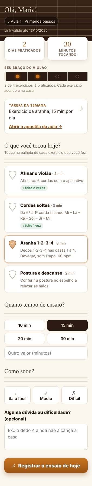
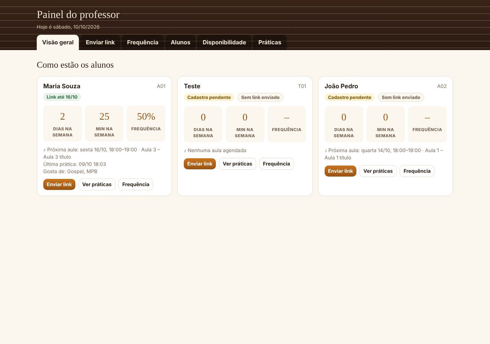
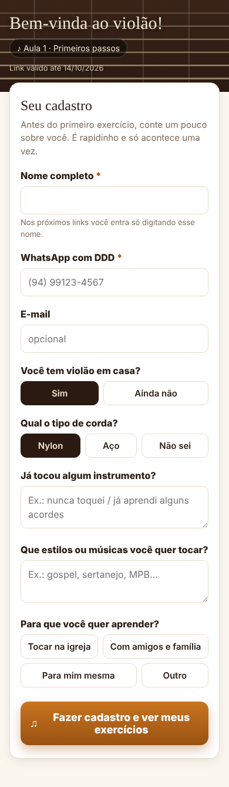
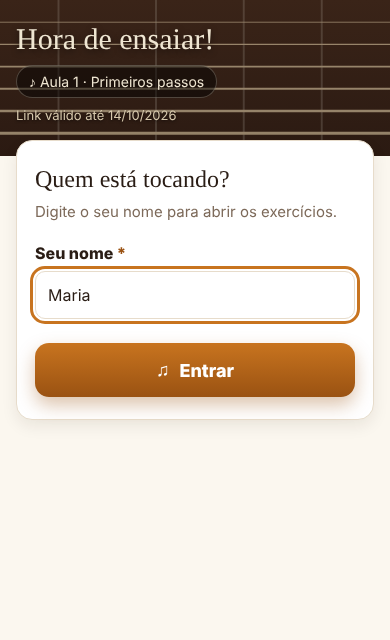
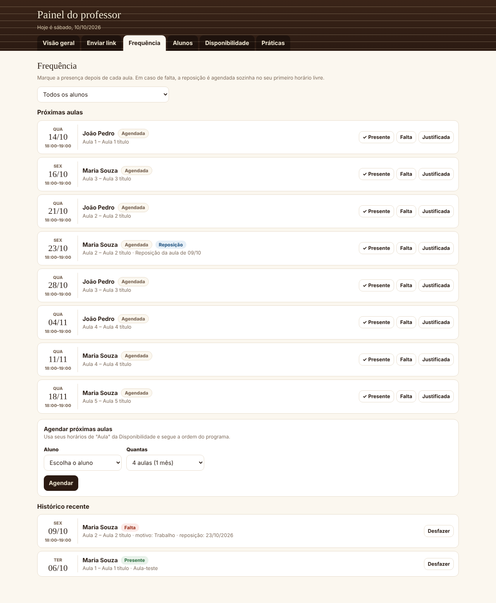
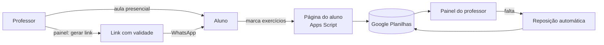

# 🎸 Violão – Acompanhamento de Aulas

Sistema gratuito em **Google Apps Script + Google Planilhas** para professores de violão acompanharem a prática dos alunos entre uma aula presencial e outra.

Depois de cada aula, o professor envia pelo WhatsApp um **link com validade até a próxima aula**. O aluno abre o link no celular, marca os exercícios que praticou e registra quanto tempo tocou. Tudo fica gravado na planilha do professor, com o nome do aluno. O professor é o único usuário do sistema: o aluno não precisa de conta nem de senha.

<p align="center">
  
  &nbsp;&nbsp;
  
</p>

## Funcionalidades

**Para o aluno (página pública, sem login)**
- Cadastro no primeiro acesso: nome, WhatsApp, tipo de violão, estilos que gosta e objetivo.
- Nos links seguintes, entra só digitando o nome.
- Marca os exercícios da aula, informa os minutos de prática, a dificuldade e deixa dúvidas.
- Vê o próprio progresso: dias praticados, minutos e as "casas do braço" que vão acendendo.
- Funciona no celular e no computador.

**Para o professor (painel privado)**
- **Visão geral** de cada aluno: dias e minutos de prática na semana, frequência, próxima aula e alertas como "3 dias sem praticar".
- **Enviar link**: gera o link da aula com validade e abre o WhatsApp com a mensagem pronta.
- **Frequência**: marca Presente, Falta ou Falta justificada (com motivo). Na falta, **agenda a reposição sozinho** no primeiro horário livre.
- **Agendamento automático** das próximas aulas, seguindo a ordem do programa e a disponibilidade do professor.
- **Disponibilidade**: horários semanais (aula, reposição ou ambos) e exceções por data.
- **Alunos**: cadastro, plano, mensalidade, liberar aparelho novo e refazer cadastro.
- **Aulas**: ver e editar o conteúdo, a tarefa, a apostila e os exercícios de cada aula, e criar aulas novas.
- **Práticas**: tudo o que os alunos registraram, com os comentários.

**Segurança**
- Cada link tem um código aleatório e **para de funcionar na data de validade**.
- **Trava por aparelho**: o link só abre nos aparelhos que o aluno usou no cadastro (até 2: celular e computador).
- O painel do professor só abre pelo menu da planilha ou com **senha** (guardada como hash, com bloqueio após 5 tentativas erradas).
- As funções administrativas só rodam para o dono do script.

## Capturas de tela

| Cadastro do aluno | Entrada só com o nome | Painel: frequência |
|---|---|---|
|  |  |  |

## Como funciona



Todos os dados ficam numa planilha do Google Drive do professor:

| Aba | Conteúdo |
|---|---|
| Alunos | Cadastro, plano, mensalidade, aparelhos liberados |
| Aulas / Exercicios | O programa de aulas e os exercícios de cada uma |
| Envios | Links enviados, com código e validade |
| Disponibilidade | Horários do professor e exceções por data |
| Frequencia | Aulas agendadas, presenças, faltas e reposições |
| Registros | Cada prática registrada pelos alunos |
| Resumo / Mensalidades | Indicadores e controle de pagamento |

O programa já vem com **10 aulas para iniciantes** (do zero até dedilhado e leitura de cifra). Você pode trocar tudo nas abas Aulas e Exercicios.

## Instalação

### Opção 1: copiar e colar (sem programação)

1. Crie uma planilha nova no Google Drive.
2. Na planilha, vá em **Extensões > Apps Script**.
3. Crie os arquivos abaixo com o botão **+** e cole o conteúdo de cada arquivo da pasta [`src/`](src):

   | Arquivo no Apps Script | Tipo | Conteúdo |
   |---|---|---|
   | `Código` | Script | `src/Codigo.gs` |
   | `Configurar` | Script | `src/Configurar.gs` |
   | `PainelServidor` | Script | `src/PainelServidor.gs` |
   | `Index` | HTML | `src/Index.html` |
   | `Painel` | HTML | `src/Painel.html` |

4. Salve, escolha a função **configurarPlanilha** e clique em **▶ Executar**. Autorize o acesso quando o Google pedir (em "O Google não verificou este app", clique em **Avançado > Acessar**). Rode só uma vez: ele monta todas as abas.
5. Vá em **Implantar > Nova implantação > App da Web** e configure:
   - **Executar como:** Eu
   - **Quem pode acessar:** Qualquer pessoa
6. Recarregue a planilha e use **Violão > Definir URL do web app** para colar a URL que termina em `/exec`.
7. Abra **Violão > Abrir painel do professor**.

### Opção 2: com o [clasp](https://github.com/google/clasp)

```bash
npm install -g @google/clasp
clasp login
clasp create --type sheets --title "Violão – Acompanhamento" --rootDir src
clasp push
```

Depois siga os passos 4 a 7 acima. Use `.clasp.json.example` como modelo. O arquivo `.clasp.json` fica fora do Git porque contém o ID do seu projeto.

## Uso no dia a dia

1. **Depois da aula**, no painel: aba **Frequência** → marque a presença. Depois, na aba **Enviar link**, gere o link da aula e envie pelo WhatsApp.
2. **Durante a semana**, o aluno registra a prática. Acompanhe pela **Visão geral** e pela aba **Práticas**.
3. **No começo do mês**, use **Agendar próximas aulas** na aba Frequência.
4. **Se o aluno trocar de celular**, use **Liberar aparelho novo** na aba Alunos.

Para abrir o painel no celular, use **Violão > Link do painel no celular**. Guarde esse link só para você. Se ele vazar, use **Violão > Trocar chave do painel**.

## Usar como app no celular (PWA)

A pasta [`docs/`](docs) tem **dois apps instaláveis** que rodam de graça no GitHub Pages:

| App | Endereço | Para quem |
|---|---|---|
| **Violão** | `https://SEU-USUARIO.github.io/violao-acompanhamento/` | Alunos: abre pelo link do WhatsApp e lembra do último link |
| **Violão Prof.** | `https://SEU-USUARIO.github.io/violao-acompanhamento/professor.html` | Professor: painel protegido por senha |

1. No GitHub, abra **Settings > Pages**. Em **Branch**, escolha `main` e a pasta `/docs`, e clique em **Save**.
2. Em `docs/config.js`, coloque a URL do **seu** web app (a que termina em `/exec`).
3. Na planilha, use **Violão > Definir endereço do app (GitHub Pages)** e cole o endereço do app dos alunos. A partir daí, os links enviados abrem pelo app.
4. Na planilha, use **Violão > Definir senha do painel** para criar a senha do professor.
5. Para instalar, abra o endereço e toque em **Instalar** (Android) ou em **Compartilhar > Adicionar à Tela de Início** (iPhone).

O painel pede a senha e pode lembrar o aparelho por 30 dias. A senha fica guardada só como hash (SHA-256 com sal). Depois de 5 tentativas erradas, o acesso é bloqueado por 15 minutos. **Violão > Desconectar todos os aparelhos do painel** encerra todas as sessões.

## Atualizando o código

Depois de alterar os arquivos, vá em **Implantar > Gerenciar implantações > ✏️ Editar > Versão: Nova versão > Implantar**. Assim a URL continua a mesma e os links já enviados seguem funcionando.

## Privacidade (LGPD)

O sistema guarda dados pessoais de alunos: nome, telefone e e-mail. Esses dados ficam **somente na planilha do Google Drive do professor**, e nada é enviado para servidores de terceiros. Não publique a planilha nem exportações dela: o `.gitignore` já ignora arquivos `.xlsx` e `.csv`. Peça a autorização do aluno (ou do responsável, se for menor de idade) antes do cadastro.

## Limitações

- Sem senha, nenhuma trava é perfeita: o aluno ainda pode emprestar o próprio celular para outra pessoa. A conferência de verdade continua sendo a aula presencial.
- O Google mostra um aviso "Este aplicativo foi criado por um usuário do Google Apps Script" no topo da página. Isso é padrão de todo web app do Apps Script.
- As cotas gratuitas do Apps Script atendem com folga um professor com poucos alunos.

## Estrutura do repositório

```
src/
  Codigo.gs        página do aluno, links, cadastro, trava por aparelho e reposição automática
  PainelServidor.gs servidor do painel do professor (protegido por chave)
  Configurar.gs    monta a planilha na primeira instalação
  Index.html       página do aluno
  Painel.html      painel do professor
  appsscript.json  manifesto do projeto
docs/              app instalável (GitHub Pages): index.html, manifest, service worker e ícones
docs/imagens/      capturas de tela
```

## Licença

[MIT](LICENSE) © 2026 Oscar dos Santos Silva Neto
